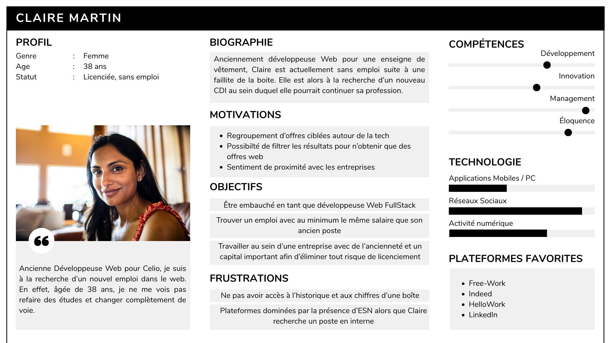
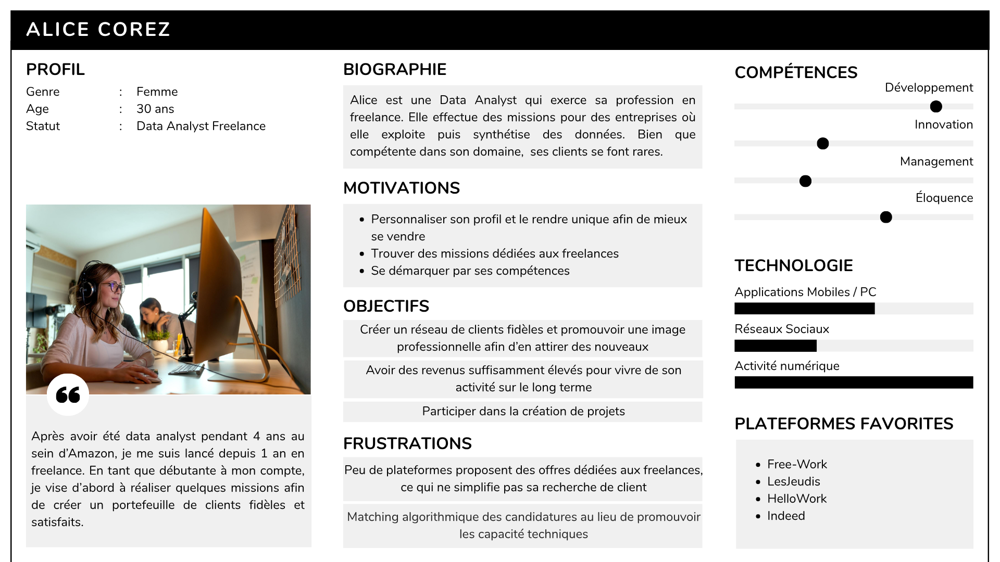

# Clients ciblés

## 1. La communauté que nous cherchons à atteindre

&nbsp;&nbsp;&nbsp;&nbsp;&nbsp;<i>Tech Your Job</i> est une plateforme d'offres d'emploi qui s'adresse avant tout au secteur de l'informatique et l'ensemble des sous-domaines qu'il comprend. Le but est de proposer des annonces adaptées à plusieurs types de profil afin d'élargir le nombre d'utilisateurs potentiels. Parmi eux, nous pensons notamment :

- aux étudiants à la recherche d'un stage,
- aux jeunes diplômés recherchant un premier emploi,
- aux freelances recherchant des missions afin d'agrandir leur portefeuille client,
- aux nouveaux développeurs en reconversion professionnelle,
- aux personnes sans emploi pour diverses et autres raisons (licenciement économique, fin de contrat, etc)

&nbsp;&nbsp;&nbsp;&nbsp;&nbsp;À long terme, si le projet est prometteur, notre ambition serait de diffuser notre service à l'échelle internationale car la recherche d'emploi ne s'arrête pas aux frontières, surtout dans l'informatique où de nombreux sièges d'entreprises sont souvent à l'étranger.

&nbsp;&nbsp;&nbsp;&nbsp;&nbsp;Finalement, si le temps nous le permet, nous aimerions offrir la possibilité aux entreprises de créer leur propre compte sur notre plateforme afin d'eux-même poster des annonces et augmenter leur visibilté. En effet, il s'agit dans un premier temps de récupérer manuellement des annonces déjà existentes.

## 2. Leurs besoins

**Candidats**

- Pouvoir se démarquer des autres postulants par leurs compétences et ne pas être piégé par un algorithme

- Accéder à un vaste nombre d'offres tech sur une seule application

- Filtrer les annonces par domaine, salaire, contrat, modalités, etc afin d'avoir des résultats personnalisés et trouver un emploi respectant ses attentes

- Pouvoir contacter les recruteurs facilement et avoir un sentiment de proximité (possibilité d'échanger par message ou par vidéo pour un entretien par exemple)

- Être accompagné dans les démarches de recherche d'emploi

=> Un candidat veux avant tout trouver un emploi adapté à ses attentes sans laisser de place au hasard de l'algorithme

**Entreprises**

- Publier des offres d'emploi afin de trouver des salariés

- Entrer en contact rapidement et facilement avec les candidats

- Mettre en valeur leurs publications avec un système de sponsoring

- Obtenir des données et statistiques concernant leur profil entreprises (nombre de candidat total, nombre de vue de profil, nombre de fois où l'entreprise a été mentionnée, recherchée, etc) afin d'estimer leur visibilité

=> Une entreprise veut avant tout faire sa pub pour attirer des nouveaux collaborateurs.

## 3. Personas

